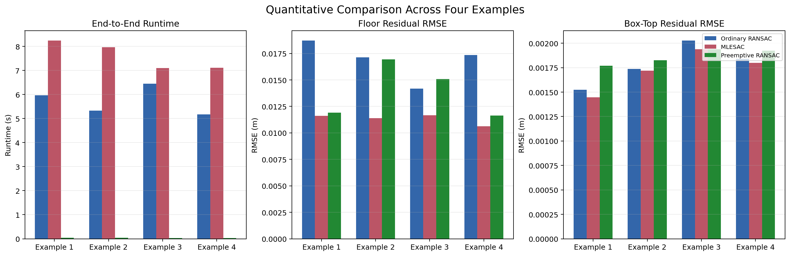
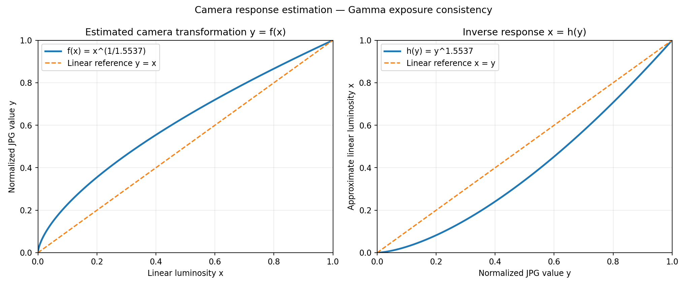
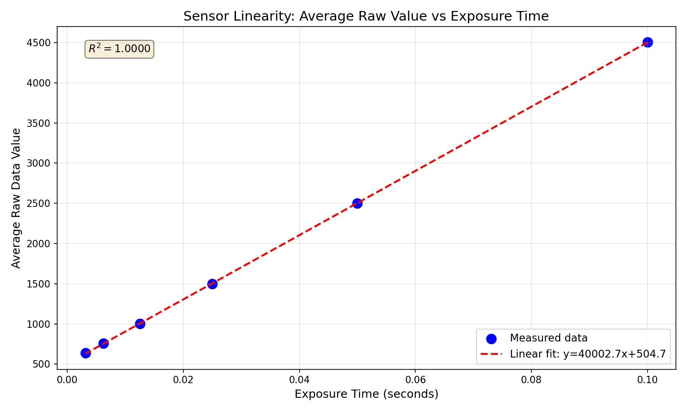
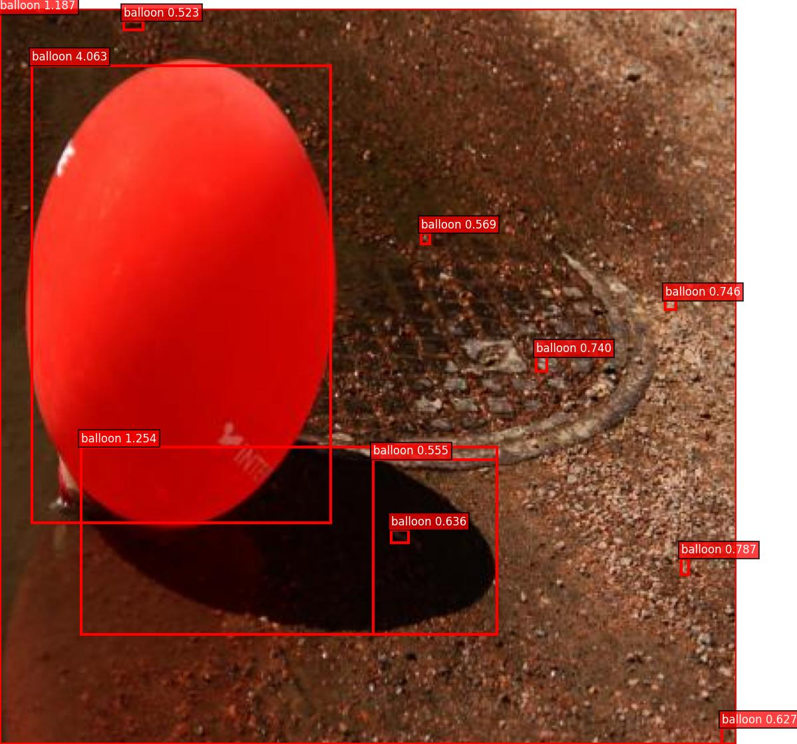
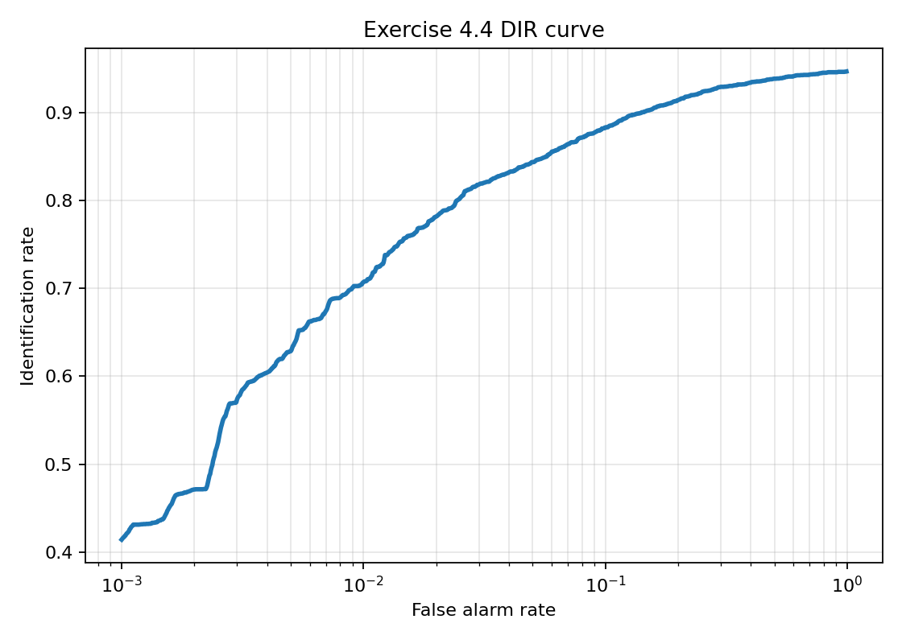

# CVKit

**A modular computer vision toolkit — from RAW sensor data to face recognition.**

CVKit is a personal engineering project that turns a set of classical and
embedding-based computer-vision techniques into one coherent, reusable system.
It covers the full stack that modern vision pipelines still depend on:
sensor-level image formation, geometry and robust model fitting, local-feature
retrieval, region-proposal detection, and face analysis. Every subsystem shares
one data layout, one Python package and one command-line interface.

Rather than a notebook per topic, the goal was to answer a practical question:
*what does it take to make ten different vision algorithms behave like one
product?* The result is a small toolkit (≈11k lines of library code) with a
unified API, reproducible benchmarks and an interactive studio.

```
Depth camera ─┐
RAW / JPEG  ─┼─►  cvkit  ─►  measurements, retrieved images, detections, identities
Video       ─┘
```

## Contents

[Highlights](#highlights) ·
[Design](#design) ·
[Installation](#installation) ·
[Quick start](#quick-start) ·
[Results](#results) ·
[Technical approach](#technical-approach) ·
[Reproducing the benchmarks](#reproducing-the-benchmarks) ·
[Data](#data) ·
[Testing](#testing)

---

## Highlights

| Subsystem | Problem | Approach | Reference result |
|---|---|---|---|
| **Geometry** | Measure a box from a noisy depth point cloud | RANSAC / MLESAC / Preemptive RANSAC + PCA sizing | Preemptive RANSAC runs **≈160× faster** (5.96 s → 0.037 s) with the same segmentation |
| **Imaging** | Develop RAW captures and recover HDR radiance | Bayer demosaicing, Gray-World WB, sensor-linearity calibration, gamma response estimation, iCAM06 | Three independent estimators recover **γ ≈ 1.2–1.55**; linearity verified across 6 exposures |
| **Retrieval** | Find images of the same writer | RootSIFT → VLAD → power/intra-norm → exemplar SVM | Top-1 **0.819 → 0.895**, mAP **0.629 → 0.765** |
| **Detection** | Locate balloons without deep learning | Selective Search + HOG + linear SVM + NMS | mAP **0.125 → 0.180** (+44%), MABO **0.557 → 0.633** |
| **Faces** | Detect, track, recognise and reject unknown identities | MTCNN + FaceNet embeddings + k-NN/k-means + SPL/MPL | Rank-1 **1.00** closed-set, **100%** unknown rejection, **0.978** open-set AUC |

All numbers are reproducible from the scripts in `benchmarks/`; the full tables are in
[`docs/benchmarks.md`](docs/benchmarks.md).

---

## Design

The project is built around four rules:

1. **One package, five bounded contexts.** `cvkit.geometry`, `cvkit.imaging`,
   `cvkit.retrieval`, `cvkit.detection`, `cvkit.faces`. Modules never import each
   other's internals; shared concerns live in `cvkit.paths` and `cvkit.common`.
2. **Library first, interface second.** Every capability is a function or class that
   can be imported. The CLI (`python -m cvkit`) and the Streamlit studio are thin
   wrappers over the same code — no duplicated logic.
3. **Explicit geometry conventions.** A plane is always `(normal, offset)` with
   `normal · x = offset`; boxes are `(x1, y1, x2, y2)` with exclusive bottom-right;
   features are always L2-normalised before cosine ranking.
4. **Reproducibility over cleverness.** Every randomised routine accepts a seed, every
   stage writes a machine-readable artefact (CSV/JSON), and every headline number in
   the docs comes from a committed script.

### Repository layout

```
.
├── src/cvkit/              # the library
│   ├── cli.py              # python -m cvkit ...
│   ├── paths.py            # single source of truth for data/output paths
│   ├── geometry/           # point clouds, plane fitting, box measurement
│   ├── imaging/            # demosaicing, calibration, response, HDR
│   ├── retrieval/          # SIFT/VLAD retrieval + ablation experiments
│   ├── detection/          # selective search, HOG/SVM, COCO evaluation
│   └── faces/              # MTCNN, FaceNet, clustering, open-set
├── apps/
│   ├── studio.py           # Streamlit entry point
│   └── pages/              # one page per subsystem
├── benchmarks/             # reproducible experiment drivers
├── docs/                   # architecture, benchmarks, data, figures
├── data/                   # datasets (large files are not committed)
├── outputs/                # generated artefacts (git-ignored)
└── tests/                  # unit tests for the pure algorithms
```

---

## Installation

Python 3.10+ is recommended.

```bash
git clone https://github.com/yingchao-li/CV-Tool-Platform.git cvkit
cd cvkit

python -m venv .venv
source .venv/bin/activate          # Windows: .venv\Scripts\activate

pip install -e .                   # core dependencies
pip install -e ".[app]"            # + Streamlit studio
```

Optional extras:

```bash
pip install -e ".[coco]"           # official pycocotools mAP
pip install -e ".[dev]"            # pytest, ruff
```

---

## Quick start

### Point-cloud box measurement

```bash
python -m cvkit geometry --example 1 --method preemptive
python -m cvkit geometry --example 3 --method mlesac --json outputs/geometry/box3.json
```

```python
from cvkit.geometry import load_example, measure_box

_, _, cloud = load_example(1)
result = measure_box(cloud, method="mlesac")
print(result.height, result.length, result.width)
print(result.as_dict())
```

### RAW development and HDR

```bash
python -m cvkit imaging demosaic                # single CR3 -> JPEG preview
python -m cvkit imaging linearity               # sensor response across 6 exposures
python -m cvkit imaging hdr                     # merge RAW bracket + log tone map
python -m cvkit imaging icam06                  # iCAM06 tone mapping
python -m cvkit imaging response --method gamma # estimate JPEG gamma + HDR merge
```

### Image retrieval

The writer-identification dataset (ICDAR 2017 binary images) is not redistributed;
point the CLI at your local copy:

```bash
python -m cvkit retrieval run \
  --in_train /data/icdar2017-training-binary \
  --in_test  /data/ScriptNet-HistoricalWI-2017-binarized \
  --labels_train /data/icdar17_labels_train.txt \
  --labels_test  /data/icdar17_labels_test.txt \
  --powernorm
```

Ablations (intra-normalisation, PCA whitening, AQE, codebook size, inversion):

```bash
python -m cvkit retrieval experiment pca --help
python -m cvkit retrieval experiment pca --pca_dims 1024 --powernorm
```

### Object detection

```bash
python -m cvkit detection run          # proposals -> train -> infer -> evaluate
python -m cvkit detection tune         # bounded validation-driven search
python scripts/selective_search_demo.py
```

### Face analysis

```bash
python -m cvkit faces train --mode ident --label Alan_Ball --video "data/faces/train_data/Alan_Ball/%04d.jpg"
python -m cvkit faces infer --mode ident --video "data/faces/test_data/Alan_Ball/%04d.jpg"
python -m cvkit faces openset          # SPL / MPL open-set experiment
python -m cvkit faces camera           # webcam tracking demo
```

### Interactive studio

```bash
streamlit run apps/studio.py
```

The studio exposes one page per subsystem: geometry measurement, RAW pipeline,
response estimation, retrieval experiments, detection and the face benchmark
browser.

---

## Results

### Geometry — robust plane fitting

Three estimators on the same capture (`example1kinect.mat`), 1000 RANSAC
iterations, floor ε = 0.05 m, box ε = 0.005 m:

| Method | Runtime (s) | Floor inliers | Box-top inliers | Floor RMSE | Box RMSE | Height (m) |
|---|---:|---:|---:|---:|---:|---:|
| RANSAC | 5.9625 | 156 215 | 35 938 | 0.0187 | 0.00152 | 0.1725 |
| MLESAC | 8.2402 | 154 626 | 35 954 | **0.0116** | **0.00145** | 0.1929 |
| Preemptive RANSAC | **0.0372** | 154 901 | 35 799 | 0.0119 | 0.00177 | 0.1981 |

MLESAC gives the tightest planes; Preemptive RANSAC is two orders of magnitude
faster while producing the same segmentation. The trade-off is analysed in
[`docs/benchmarks.md`](docs/benchmarks.md#geometry).



### Imaging — sensor response and HDR

Exposure-consistency, pairwise-ratio and quantile-matching estimators recover
γ = **1.554**, **1.171** and **1.216** respectively from the same six-frame JPEG
bracket — a useful agreement given that each method uses a different statistic.



The linearity check uses six RAW exposures from 1/10 s to 1/320 s and confirms
that the sensor response is linear before tone mapping.



### Retrieval — VLAD ablations

Writer identification on the ICDAR 2017 benchmark (Top-1 / mAP):

| Configuration | Top-1 | mAP |
|---|---:|---:|
| Base VLAD | 0.8189 | 0.6294 |
| + power normalisation | 0.8314 | 0.6430 |
| + exemplar SVM | **0.8947** | **0.7653** |
| + intra-normalisation | 0.8369 | 0.6481 |
| + PCA whitening (1024-D) | 0.8847 | 0.7443 |
| Codebook K = 200 | 0.8389 | 0.6567 |

Exemplar SVM is the single largest gain (+0.12 mAP). Average query expansion and
image inversion both *hurt* performance — negative results are documented rather
than hidden.

### Detection — Selective Search + HOG/SVM

| Stage | Split | MABO | mAP@[.50:.95] |
|---|---|---:|---:|
| Baseline | test | 0.5567 | 0.1246 |
| Tuned | valid | 0.6296 | 0.0845 |
| Tuned | test | **0.6327** | **0.1797** |

The two-stage search tunes proposals on validation data and touches the test
split exactly once, so the reported gain (+13.7% MABO, +44.2% mAP) is not the
result of test-set tuning.



*Detections from the recall-oriented search configuration. Precision can be
raised by sweeping `score_threshold` on the validation split.*

### Faces — recognition and open-set rejection

| Experiment | Result |
|---|---|
| Tracking (25 px window, 0.50 threshold) | 33/45 frames by template matching, 12 MTCNN calls, 0.0125 s/frame |
| Closed-set rank-1 | **1.000** |
| Known-ID rate after rejection | 0.950 |
| Unknown rejection (k=1, distance rule) | **1.000** |
| Clustering purity (seed 42) | 0.978 |
| DIR @ FAR = 1% | 0.707 |
| SPL open-set AUC | 0.978 |

The open-set study also compares six scoring rules. Fusing distance and
classifier margins raises AUC to 0.983 but collapses the operating point
(actual FAR 0.18% at a 10% budget), so the simpler distance rule is kept.



---

## Technical approach

Every subsystem follows the same three-part shape: a **representation** stage
that turns raw input into a geometric or statistical object, a **scoring** stage
that compares competing hypotheses, and a **decision** stage with explicit,
inspectable thresholds. The five sections below describe the route through the
data, the method used at each step, and what that design buys — and costs.

### 1. Geometry — metric box measurement

**Route**

```text
.mat capture (amplitude, depth, H x W x 3 cloud)
  └─ valid points            drop pixels with z = 0
      └─ robust plane fit    floor
          └─ mask cleanup    closing → opening → component filter → hole fill
              └─ complement  non-floor points
                  └─ robust plane fit   box top
                      └─ largest connected component
                          └─ PCA sizing + corners
```

**Methods**

- **Point validity.** Pixels with `z = 0` are missing depth returns and are
  removed before fitting. All valid points are kept as an `(N, 3)` array,
  together with their `(row, col)` indices so any 1D inlier mask can be
  projected back onto the image grid.
- **Plane model.** A plane is `(n, d)` with `n · x = d` and `‖n‖ = 1`, so
  `|n · x − d|` is a metric distance in metres. Every estimator returns this
  same pair, which removes the usual confusion between `n·x = d` and
  `n·x + d = 0`.
- **Three estimators.** They share the same 3-point minimal solver and differ
  only in how hypotheses are scored:

  | Estimator | Objective | Sampling | Typical cost |
  |---|---|---|---|
  | RANSAC | maximise inlier count | 1000 three-point samples | `O(N)` per hypothesis |
  | MLESAC | minimise `Σ (dᵢ if dᵢ < ε else γ)` | same sampler | `O(N)` per hypothesis |
  | Preemptive RANSAC | minimise accumulated outlier count | `M = 200` hypotheses, `B = 100` points per batch, discard the worse half after each batch | ≈ `O(M·N / B)` |

  RANSAC is the baseline. MLESAC replaces the hard inlier count with a
  truncated residual cost, so it prefers a slightly smaller but geometrically
  tighter plane. Preemptive RANSAC is the efficiency play: most hypotheses are
  eliminated after seeing a few hundred points.
- **Floor cleanup.** Five iterations of an 8-connected closing followed by
  five iterations of opening remove speckle and bridge small gaps. Components
  smaller than `min_floor_size` are dropped, and holes smaller than
  `max_hole_size` are filled — but only if the hole does not touch the image
  border, so background is never flooded.
- **Box top.** The complement of the floor mask yields the non-floor points; a
  second plane fit finds the top surface, and the largest connected component
  removes remaining clutter.
- **Sizing.** Height is the distance between the two planes after aligning their
  normals (`|d_floor − d_top|`). Length and width are the extents of the top
  points along the first two PCA directions, so a rotated box is still
  measured correctly. Corners are the bounding rectangle in that PCA frame
  mapped back to 3D.
- **Output.** `BoxMeasurement` bundles the two planes, inlier masks, inlier
  counts, per-plane RMSE, dimensions, corners and the cleaned masks;
  `as_dict()` is the JSON boundary used by the CLI and the studio.

**Characteristics**

- Metric output in metres, no training data, CPU only, deterministic with a
  fixed seed.
- Robust to a substantial fraction of invalid pixels and non-planar clutter;
  the same capture can be processed by all three estimators for comparison.
- **Assumptions and limits:** a dominant floor plane, a mostly planar box top,
  and near-parallel planes for the height formula. Distance thresholds are in
  metres and must be set per sensor. PCA extents are biased if a large part of
  the top surface is missing.

### 2. Imaging — RAW development, sensor calibration and HDR

**Route**

```text
CR3 ──► CFA ──► black level ──► demosaic ──► white balance ──► display transform ──► JPEG
JPEG bracket ──► inverse response ──► exposure scaling ──► radiance merge ──► tone map
```

**Methods**

- **RAW development.** `rawpy` exposes the visible colour-filter array. A black
  level is estimated at the 1st percentile and subtracted. Demosaicing is a
  normalised masked convolution,

  ```text
  C(x) = (M_c · X * K)(x) / (M_c * K)(x)
  ```

  where `M_c` marks the samples of channel `c` and `K` is a 3×3 averaging
  kernel; the denominator makes the interpolation edge-safe instead of
  assuming a full neighbourhood.
- **White balance and display.** Gray-World WB scales each channel by
  `mean(image) / mean(channel)`. Percentile normalisation (0.01–99.99) maps the
  linear image into `[0, 1]`, a gamma of 0.38 encodes it for display, and a
  final brightness/contrast/saturation step mimics a manual grade.
- **Sensor linearity.** Six RAW exposures from 1/10 s to 1/320 s are averaged
  and fitted with a first-order polynomial. The reported `R²` decides whether
  the linear radiance model is justified before HDR merging.
- **HDR merge (RAW).** The longest exposure seeds the radiance estimate `h`.
  A threshold at 80% of its maximum marks near-saturated pixels. Each shorter
  exposure is scaled by its known exposure ratio (`2^k` for the halving
  bracket) and replaces only the saturated pixels; the *unscaled* sensor values
  are kept so a pixel that is still saturated can be replaced again by the next
  frame. The same primitive is used for RAW and JPEG brackets.
- **Tone mapping.** Two display operators are provided: a log map
  (`log(1 + x)` followed by a percentile stretch) and a simplified iCAM06 that
  decomposes log intensity into a bilateral base layer and a detail layer,
  compresses only the base to a target dynamic range, and restores the
  chromaticity ratios.
- **JPEG inverse response.** The camera response is modelled as
  `h(y) = y^γ`. Three independent estimators recover `γ`:
  1. **exposure consistency** — minimise the weighted relative RMSE of
     exposure-normalised intensities across all frames;
  2. **pairwise ratios** — minimise the log-ratio error between adjacent
     frames given their known exposure ratio;
  3. **quantile matching** — align luminance quantiles after exposure
     normalisation.

  The linearised frames are then merged with the shared radiance merge and
  tone-mapped, so the JPEG and RAW routes differ only in how radiance is
  recovered.
- **Memory behaviour.** The JPEG bracket is linearised and merged in 256-row
  chunks, so a full-resolution frame never has to be resident twice as float64.

**Characteristics**

- Physically motivated: radiance is reconstructed before any display curve is
  applied, and calibration is verified independently of the HDR result.
- One merge implementation for both input formats keeps the two routes
  numerically consistent and avoids two divergent HDR code paths.
- **Assumptions and limits:** bilinear demosaicing is not edge-aware; the JPEG
  model is a single gamma rather than a full response curve, so it cannot
  represent a shoulder or toe; the RAW bracket assumes halving exposures; the
  iCAM06 implementation is deliberately simplified (no IPT or chromatic
  adaptation), so it should be read as a local tone mapper inspired by iCAM06,
  not a reference implementation.

### 3. Retrieval — RootSIFT + VLAD

**Route**

```text
image ──► RootSIFT ──► codebook (k-means) ──► VLAD residuals
      ──► normalisation ──► [PCA | intra-norm | E-SVM | AQE] ──► cosine ranking
```

**Methods**

- **Descriptor.** OpenCV SIFT with every keypoint orientation fixed to `0`
  (upright, no rotation invariance), followed by RootSIFT: L1-normalise the
  128-D descriptor, then take the element-wise square root (Hellinger
  normalisation).
- **Codebook.** Mini-batch k-means over at most 500k descriptors sampled from
  at most 100 training images, with `K = 100` visual words by default. Sampling
  is seeded, and images without keypoints are skipped.
- **VLAD encoding.** Each descriptor is hard-assigned to its nearest visual
  word and the residuals are accumulated per word:

  ```text
  v_k = Σ_{i : NN(x_i) = k} (x_i − μ_k),    v = [v_1, …, v_K]
  ```

  With `K = 100` and `D = 128` the descriptor is 12 800-D per image.
- **Normalisation.** Two variants are supported: signed square-root (power)
  normalisation followed by L2, and intra-normalisation, which L2-normalises
  each `v_k` block *before* concatenation and then applies power + L2. The
  latter limits the influence of bursty visual words.
- **Exemplar SVM.** For each query, a `LinearSVC(C = 1000, class_weight =
  "balanced")` is trained with the query as the only positive and the whole
  gallery as negatives; the SVM weight vector, L2-normalised, becomes the new
  query descriptor.
- **PCA whitening.** PCA is fitted on training encodings only, then applied to
  both splits and followed by L2. This is the strongest unsupervised change in
  the ablation suite.
- **Average query expansion.** The query is replaced by the mean of itself and
  its top-k neighbours and renormalised. It is implemented as a documented
  negative result: the top-k neighbours are not reliable enough on this
  benchmark.
- **Ranking and metrics.** Cosine distance is computed after renormalising the
  rows; self-matches are excluded. Retrieval is scored with Top-1 accuracy and
  mAP over the full ranking.

**Characteristics**

- Encodes once and compares cheaply: VLAD turns a variable-length set of
  descriptors into a fixed vector, so the gallery is a matrix product.
- The expensive stages are cached by a configuration hash, which makes the
  five-way ablation suite practical on a CPU.
- **Assumptions and limits:** upright SIFT loses rotation invariance; the
  global VLAD vector is sensitive to background clutter; E-SVM costs one SVM
  per query and dominates runtime; AQE only helps when the first-rank results
  are already mostly correct.

### 4. Detection — Selective Search + HOG + linear SVM

**Route**

```text
image ──► Felzenszwalb segments ──► hierarchical merging ──► proposals
      ──► IoU labelling ──► HOG ──► scaler + LinearSVC
      ──► score threshold ──► NMS ──► MABO / mAP
```

**Methods**

- **Proposals.** Felzenszwalb over-segmentation (`scale`, `sigma`,
  `min_size`) is followed by greedy merging using four similarities: colour
  histogram intersection, texture histogram intersection, region size and
  fill compactness. Every initial and merged region contributes a tight
  bounding box, so objects are proposed at multiple scales.
- **Proposal cache.** Proposals are cached per `(split, image, bbox format,
  scale, sigma, min_size, max_proposals)`. A cache entry is reused only when
  every parameter matches, which is what makes the parameter search tractable
  and prevents stale proposals from contaminating a new configuration.
- **Training labels.** A proposal is positive at `IoU ≥ 0.75`, negative at
  `IoU ≤ 0.25`; anything in between is ignored rather than forced into a class.
  Per image, the strongest 32 positives and hardest 96 negatives are kept, and
  the global negative-to-positive ratio is capped at 5:1. Optional ground-truth
  injection and jittering add positives for training only — they are never
  written to the proposal cache and never counted in MABO.
- **Features.** Each crop is resized to 64×64 and described by HOG with 9
  orientations, 8×8 cells and 2×2 blocks (L2-Hys), giving a 1 764-D vector.
- **Classifier.** `StandardScaler` followed by `LinearSVC` with balanced class
  weights. The scaler matters because HOG block norms have very different
  dynamic ranges.
- **Inference.** Decision scores are thresholded, then greedy NMS
  (`IoU > 0.3`) removes duplicates, and a per-image cap limits the output.
- **Metrics.** MABO averages, over all ground-truth objects, the best IoU any
  proposal achieves. mAP is computed over IoU 0.50–0.95 with a dependency-free
  101-point fallback; `pycocotools` can be enabled with an extra when exact
  COCO parity is required.
- **Parameter search.** A two-stage budget: 30 proposal configurations are
  ranked by validation MABO, the top 5 go through at most 3 training
  configurations each (≤ 15 models, ≤ 50 trials), and the objective is
  `mAP + 0.2 × MABO`. Tuning is done on validation; the test split is evaluated
  once, at the end.

**Characteristics**

- CPU-only, interpretable and dependency-light: no pretrained detector and no
  GPU. Every design choice maps to a named parameter.
- The proposal cache turns a search that would be hours into minutes.
- **Assumptions and limits:** detector quality is bounded by proposal recall;
  HOG on a warped 64×64 crop has no context and is sensitive to aspect-ratio
  distortion; the best searched configuration is deliberately
  recall-oriented, so precision must be recovered with a score threshold on
  validation data.

### 5. Faces — detect, embed, decide

**Route**

```text
frame ──► MTCNN ──► crop + resize 224×224 ──► FaceNet 128-D
      ──► color + grayscale embeddings ──► gallery k-NN / k-means / SPL-MPL
      ──► accept identity or reject as unknown
```

**Methods**

- **Detection.** MTCNN (P-Net, R-Net, O-Net) with stricter P/R thresholds
  (0.85/0.90) than the defaults; when several faces are present, the largest
  box is kept.
- **Tracking.** Between detections, `cv2.matchTemplate` with normalised
  cross-correlation searches a window around the previous box. If the peak
  score falls below the threshold, the tracker falls back to a full MTCNN
  detection, and the template is refreshed after every accepted frame. This
  cuts MTCNN calls by roughly 4× on the benchmark sequence.
- **Alignment and embedding.** The detected box is clipped, cropped and resized
  to 224×224. A FaceNet ONNX model subtracts the standard FaceNet mean, runs a
  forward pass and L2-normalises the 128-D output. Each face is embedded twice,
  in colour and in grayscale, which gives the gallery two views per sample.
- **Closed-set recognition.** Euclidean k-NN (`k = 1…7`) over the gallery
  embeddings; the label is decided by majority vote, ties broken by the
  smallest distance. The posterior is the fraction of the k neighbours that
  agree, and the reported distance is the closest agreeing neighbour.
- **Open-set rejection.** A prediction is accepted only if
  `distance ≤ τ_d` **and** `posterior ≥ τ_p`. Because the two signals fail in
  different regimes — distance catches unseen identities, posterior catches
  ambiguous neighbours — the benchmark sweeps both rules separately and
  together.
- **Clustering.** k-means on the embeddings with sample-based initialisation
  and deterministic seeds. Empty clusters are repaired by moving them to the
  sample farthest from its current centre, and the objective history is
  recorded per iteration. Labels are used only after fitting, for purity
  analysis.
- **DIR evaluation.** The similarity threshold is swept to produce
  identification rate as a function of false alarm rate; the report quotes the
  best identification rate at `FAR ≤ 1%` and the minimum FAR at
  `identification ≥ 90%`.
- **SPL / MPL open set.** Features are standardised, then an
  `SGDClassifier(loss="modified_huber")` is trained. SPL maps every KUC
  sample (an unknown identity seen during training) to one shared pseudo-class;
  MPL gives each KUC sample its own pseudo-class. Identity comes from the
  nearest known-class sample, not from the classifier's argmax. The confidence score is the
  distance margin `d(nearest KUC) − d(nearest KC)`, and a sample is rejected
  when the margin is negative or the classifier prefers a pseudo-class. This is
  why SPL and MPL produce different classifiers but identical AUC when only the
  distance margin is used.

**Characteristics**

- The backbone is frozen and swappable: replacing the ONNX model with a larger
  embedding network does not change the recognition, clustering or open-set
  logic.
- Two embeddings per face and two rejection signals make the decision stage
  explicit and tunable; every threshold is reported with its operating point.
- **Assumptions and limits:** alignment is crop-and-resize rather than a
  landmark-based warp; a global embedding degrades under occlusion (the
  measured identification rate drops from 0.95 to 0.725); the robustness
  conditions are synthetic transforms, not labelled pose/occlusion data; the
  gallery is small (five identities), so the absolute numbers should be read as
  a controlled comparison rather than a production benchmark.

**Common thread.** In all five modules the expensive part is representation —
a plane, a radiance map, a VLAD vector, a proposal set, an embedding — and the
decision stage is deliberately simple and explicit. That separation is what
makes the toolkit testable, and what makes the negative results in the
benchmark section as informative as the positive ones.

---

## Reproducing the benchmarks

```bash
python benchmarks/run_geometry.py     # geometry_comparison.csv
python benchmarks/run_faces.py        # tracking / identification / clustering / DIR
python -m cvkit detection tune        # parameter search (≈50 trials)
```

Each script writes CSV/JSON under `docs/results/` or `outputs/`, and the figures
used in this README live in `docs/assets/`.

---

## Data

Large recordings are intentionally **not** committed. The expected layout and
the provenance of every dataset are documented in [`docs/data.md`](docs/data.md).
RAW captures, face datasets and models, and the balloon dataset must be supplied locally.
Small fixtures (four point clouds, the balloon set, the painting set and the face
sequences) are enough to run most of the toolkit; RAW brackets are optional.

---

## Testing

```bash
pytest -q
```

The tests cover the pure, deterministic parts of the library: plane fitting
conventions, robust estimators, IoU/NMS, VLAD normalisation and retrieval metrics.

---

## What I would do next

- Export the geometry pipeline to Open3D and compare against RANSAC in PCL.
- Replace the hand-tuned JPG response model with a full radiometric calibration
  (Debevec) and compare tone mappers quantitatively.
- Cache HOG features on disk to make the detection search several times faster.
- Package the studio as a Docker image with a tiny sample dataset.

---

## Acknowledgements

The algorithms implemented here build on published work: RANSAC (Fischler &
Bolles), MLESAC (Torr & Zisserman), Preemptive RANSAC (Nistér), Selective Search
(van de Sande et al.), VLAD (Jégou et al.), RootSIFT (Arandjelović & Zisserman),
iCAM06 (Kuang et al.), MTCNN (Zhang et al.) and FaceNet (Schroff et al.).

Released under the MIT License. See [`LICENSE`](LICENSE).
